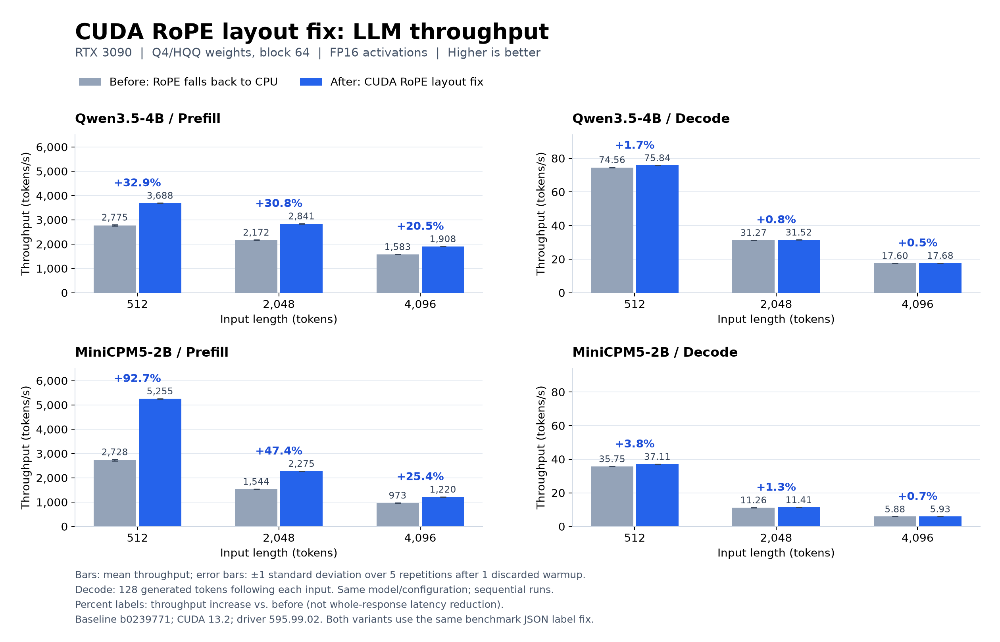

# CUDA RoPE planar-input fix: benchmark and validation evidence

Supporting artifacts for `[CUDA:Bugfix] Support planar RoPE inputs without CPU fallback`.
These files are hosted separately from the production patch.

## Benchmark



Y axis: throughput in **tokens/s** (higher is better). X axis: input length in **tokens**.
Bars show the mean of five repetitions after one discarded warmup. Error bars show ±1 standard deviation.
Percentage labels are throughput increases, not whole-response latency reductions.
Decode generates 128 tokens following each input. All performance runs were sequential.

- RTX 3090 24 GiB / sm86; NVIDIA 595.99.02; CUDA 13.2.
- Baseline: `b0239771b07b317a258fbc384683bbd540741406`.
- Both variants include the same benchmark JSON label correction. The runtime difference is the RoPE creator/layout/stride fix.
- Q4/HQQ weights, block size 64; FP16 activations; precision=2, memory=2, threads=8, KV quantization=0, flashAttention=1, mmap=0, dynamic quantization=0.
- Qwen/Qwen3.5-4B revision `851bf6e806efd8d0a36b00ddf55e13ccb7b8cd0a`.
- openbmb/MiniCPM5-2B revision `f97400052a43d642bbc6e9975e2397e3ae6a6b52`.
- This is text-only validation; complete unquantized models and a full model-quality dataset were not evaluated.

Benchmark command, with `MODEL_CONFIG` pointing to the exported text configuration and `N` set to 512, 2048 or 4096:

```sh
./llm_bench -m "$MODEL_CONFIG" -a cuda -c 2 -t 8 -p 0 -n 0 -pg "$N,128" \
  -rep 5 -qa 0 -fa 1 -mmp 0 -dyo 0 -j result.json
```

The CUDA/LLM Release build enables transformer fusion and low-memory support. CUDA 13.2 required the local option
`CUDA_NVCC_FLAGS=--static-global-template-stub=false`; the production patch does not modify CMake.

`cuda-rope-throughput.csv` and `raw/` provide means and standard deviations in tokens/s.
`verified-ab/comparison.json` also contains sampled whole-GPU memory maxima and temperature/clock ranges.
GPU sampling was approximately once per second over the whole process; these are not exact instantaneous or phase-specific memory peaks.

To regenerate the PNG and SVG, install matplotlib and run `python plot_pr_performance.py` from this directory.

## Direct-backend validation

`review_rope_layout.cpp` directly requests a CUDA RoPE execution without permitting CPU fallback.
It checks 48 cases against analytical FP32 reference values: FP32/FP16, NCHW/NC4HW4/mixed Q/K layouts,
unaligned channels (Q=18, K=6), one/multiple tokens, partial rotary dimensions and optional Q/K RMSNorm.
All cases passed; maximum absolute error was 1.43051e-6 for FP32 and 0.00125694 for FP16 in these cases.
Compute Sanitizer reported zero errors. The reproducer is development-only supporting code, licensed under Apache-2.0.

Example compile/run commands after building MNN with CUDA and transformer fusion, from this artifact directory:

```sh
g++ -std=c++17 review_rope_layout.cpp \
  -I"$MNN_SOURCE/include" -I"$MNN_SOURCE/source" -I"$MNN_SOURCE/schema/current" \
  -I"$MNN_SOURCE/3rd_party/flatbuffers/include" -I"$CUDA_ROOT/include" \
  -L"$MNN_BUILD" -L"$MNN_BUILD/source/backend/cuda" \
  -Wl,-rpath,"$MNN_BUILD" -Wl,-rpath,"$MNN_BUILD/source/backend/cuda" \
  -lMNN_Cuda_Main -lMNN -o review_rope_layout
./review_rope_layout
"$CUDA_ROOT/bin/compute-sanitizer" --tool memcheck --error-exitcode 99 ./review_rope_layout
```

Set `MNN_SOURCE`, `MNN_BUILD` and `CUDA_ROOT` to the source, build and CUDA toolkit directories.
`final-tests.json` records the existing RoPE/Softmax/MatMul/Attention suite results: 19 passed on each of CPU and CUDA.
`model-regression-summary.json` records the four model/prompt comparisons; CUDA generated texts matched exactly before/after,
while CPU wording differed and final expected answers were correct.
